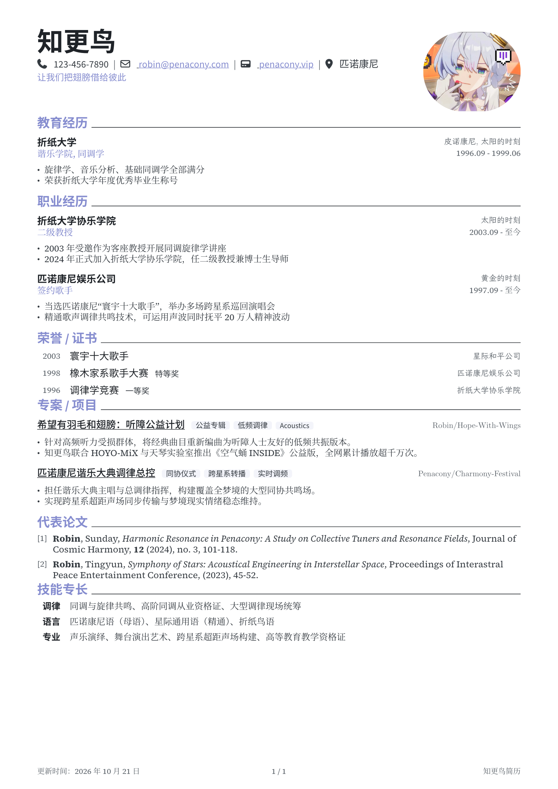

# Robin CV

基于 [brilliant-CV](https://github.com/yunanwg/brilliant-CV) 大幅精简与现代重构的中文简历模板。去除了复杂冗余的多语言抽象层，采用单文件极简排版，专注于中文场景下的优雅单页 / 多页简历呈现。

## 主要特点

1. **样式与数据解耦**：排版参数（调色板、字体、字号、间距）在 [src/theme.typ](src/theme.typ) 中直接修改生效；个人信息与全局开关在 [metadata.toml](metadata.toml) 中统一配置。
2. **现代模块化架构**：核心拆分为 [src/layout.typ](src/layout.typ) 与 [src/components.typ](src/components.typ)，[lib.typ](lib.typ) 作为极简导出入口，告别千行单体大文件。
3. **YAML 论文管理**：在 [assets/publications.yaml](assets/publications.yaml) 中录入文献，支持 AMS 与 GB/T 7714 两种排版格式，并自动加粗匹配本人姓名。

## 示例图



## 快速开始

```bash
git clone https://github.com/IceySwan/Robin-CV.git
cd Robin-CV
typst compile cv.typ
# 或实时预览：typst watch cv.typ
```

编译生成的 PDF 位于 `cv.pdf`。

## 工程结构

```text
Robin-CV/
├── lib.typ               # 模板对外统一导出入口
├── cv.typ                # 简历单文件（用户主要编辑此文件）
├── metadata.toml         # 个人信息与全局开关配置
├── src/
│   ├── theme.typ         # 颜色、字体、字号与间距样式常量
│   ├── layout.typ        # 页面框架、页眉页脚与 ATS 注入
│   └── components.typ    # 经历、项目、荣誉、技能与论文组件
├── assets/               # 静态资源与论文数据
│   ├── example.png       # 预览图
│   ├── publications.yaml # 论文数据
│   └── robin.png         # 头像示例
├── CHANGELOG.md          # 变更日志
├── LICENSE               # 开源许可证
└── README.md             # 说明文档
```

## 配置说明

### 1. 个人信息与开关（[metadata.toml](metadata.toml)）

- `cv_footer`：页脚右侧备注文本。
- `[personal]`：姓名、别名（用于论文作者加粗匹配）、电话、邮箱、一句话引言、个人主页、所在地等。
- `[inject]`：ATS 关键词列表（以微小白色文字注入页面层，供机检检索）。
- `[layout]`：头像路径与显示开关、页脚显示开关、论文引用格式（`"ams"` 或 `"gb-7714"`）、论文文件路径。

### 2. 样式与排版参数（[src/theme.typ](src/theme.typ)）

排版参数均为常量，修改数值直接生效：

- **调色板**：`accent`（强调色，默认为知更鸟蓝紫 `#868DCF`）、`text-primary`（主文字色）、`text-secondary`（正文描述）、`text-muted`（次要文字）、`tag-bg`（技术栈标签底色）等。
- **字体**：
  - `font-header`：姓名、章节标题、机构名（默认 `("Source Sans 3", "Noto Sans CJK SC")`）。
  - `font-regular`：正文字体（默认 `("Source Serif 4", "Noto Serif CJK SC")`）。
  - `font-italic`：地点、颁发机构等斜体字体（默认 `("New Computer Modern", "LXGW WenKai")`）。
- **字号**：`size-name`（28pt）、`size-section`（13.5pt）、`size-heading`（10.5pt）、`size-body`（9.5pt）、`size-note`（8.5pt）、`size-micro`（8pt）。
- **间距**：各组件 `above` / `between` 间距。文件中附有 Typst 相邻块间距与 `par.leading` 的换算逻辑。

### 3. 论文管理（[assets/publications.yaml](assets/publications.yaml)）

论文以 YAML 格式管理，支持字段：`authors`、`title`、`journal`（或 `booktitle`）、`year`、`volume`、`number`、`pages` 等。

组件 `cv-publication` 会根据 `metadata.toml` 中的 `name` 及 `name_aliases`，自动加粗作者列表中的本人。

## 常用排版组件（[src/components.typ](src/components.typ)）

- `cv-section(title)`：章节标题。
- `cv-entry(...)`：教育、职业经历条目。
- `cv-project(...)`：项目与专案条目，支持技术栈标签与仓库链接。
- `cv-honor(...)`：荣誉与证书条目，可配合 `cv-honor-date(year)` 按年份分组。
- `cv-skill(...)`：技能专长条目。
- `cv-publication(...)`：论文列表渲染。

## 缘由

最近找工作发现原本的 [简历模板](https://github.com/IceySwan/Iys-CV) 不好控制版式, 于是想到用 Typst 重写一个, 可惜学艺不精, 不能从零开始, 于是找到了 brilliant-CV, 感觉和原本的简历布局差不多, 于是进行修改. 目前基本满意, 如果不是两张简历放在一起, 基本看不出区别. 既然原本叫 Aroma, 那这个就叫 Robin 吧. 

唉, 我真是被大明星歌手给害了. 

## 致谢

- [yunanwg/brilliant-CV](https://github.com/yunanwg/brilliant-CV)
- [IceySwan/Iys-CV](https://github.com/IceySwan/Iys-CV)

## License

[MIT](LICENSE).
